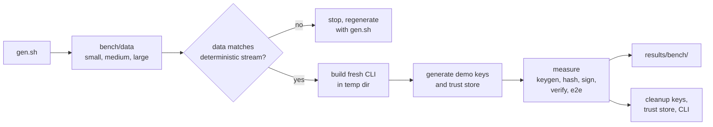

# Local benchmark

Measures the public crypto APIs and the real `release-signer` CLI for all three profiles (`rsa-pss-sha256`, `ecdsa-p256-sha256`, `ed25519`) on three artifact sizes.

## Quick start

From the repository root:

```sh
make bench            # gen data, run benchmark, write results/bench/
```

Equivalent manual steps:

```sh
sh bench/gen.sh       # generate the three input files
go run ./bench        # build a fresh CLI in a temp dir, measure, write results
go test ./bench       # unit tests and a small smoke test (never touches results/)
```

Requirements: Go (version in `go.mod`), Git, a POSIX shell, and `uname`. No extra Go modules or runtime packages.

## How a run works



Results are only published after a complete successful run, so a failed run leaves the previous results intact.

## Input data

Every artifact is the prefix of one deterministic stream: the byte at offset `i` is `i mod 256`.

| File | Size |
|---|---|
| `small.bin` | 1 KiB |
| `medium.bin` | 1 MiB |
| `large.bin` | 100 MiB |

```text
offset: 0    1    2   ...  255  256  257  ...
byte:   0x00 0x01 0x02 ... 0xff 0x00 0x01 ...
```

- All profiles use the same files.
- Files live in the git-ignored `bench/data/`, and `files.txt` records exact byte counts and SHA-256 hashes.
- Existing data is checked against the stream before measuring.

Demo keys are generated fresh each run, stay fixed across that run's artifacts and sign/verify rounds, and are deleted with the temporary trust store and CLI. No private key bytes are written to results.

## What is measured

Each metric has 30 samples. Rounds are serial, and every timer uses `time.Now` and `time.Since` (Go monotonic clock). Preparation, subprocess construction, validation and report writing are outside timing. Each completed operation is checked for success.

| Metric | Operation | Warmups |
|---|---|---|
| `keygen` | `keys.Generate`, then public key and profile validation (untimed) | 0 |
| `hash` | `sha256.Sum256` of artifact bytes already in memory | 5 |
| `sign` | `sigalg.Sign` over the original canonical manifest bytes | 5 |
| `verify` | `sigalg.Verify` over the same manifest bytes | 5 |
| `e2e_sign` | real `release-signer sign` subprocess | 5 |
| `e2e_verify` | real `release-signer verify` subprocess | 5 |

Details per metric:

- `sign` and `verify`: manifest construction and artifact hashing are outside timing, profile-internal hashing of the manifest is included, and there is no I/O in the timed region. Each signature is checked afterward.
- `e2e_sign`: includes process startup, key/trust/bundle parsing, artifact I/O and hashing, bundle write with fsync, and the signer's built-in signature self-check. Sign uses `--force` to replace the same output path, and every new bundle is checked with an extra untimed CLI verify.
- `e2e_verify`: the JSON output must report `valid: true`, `status: "OK"`, and the expected keyid, package, version and algorithm.
- Demo key/trust setup and the binary build are outside timing.

## Output files

```text
results/bench/
├── env.txt          CPU, cores, RAM, OS/kernel, Go and binary version, UTC, source commit
├── files.txt        byte count and SHA-256 of each input file
├── summary.json     all statistics, in nanoseconds
├── summary.md       same statistics in milliseconds, plus sizes
└── raw/             one CSV per metric, profile and artifact
```

Raw CSV format: exactly 30 **headerless** lines, one integer nanosecond value per line in measurement order, warmups excluded.

```text
$ head -3 results/bench/raw/e2e_sign_ed25519_small.bin.csv
3457254
3442458
3530112
```

| Metric group | Files per run |
|---|---|
| `keygen` (artifact `none`) | 3, one per profile |
| every other metric | 9, profile x artifact |

Total: 3 + 5 x 9 = 48 CSV files.

`summary.md` shows milliseconds, key sizes (DER SPKI and DER PKCS#8), raw signature sizes and actual bundle file sizes.

### Statistics

- Median averages the middle pair when the sample count is even.
- p95 uses nearest rank `ceil(0.95 * n)`, which is rank 29 for 30 samples.

## Caveats

Results are machine-local measurements, not controlled-hardware evidence:

- no CPU pinning, frequency locking or cache eviction, and the machine is not asserted to be idle
- filesystem caches may be warm, and the untimed per-sign verify also reads the artifact
- random key generation, OS scheduling and system load cause variation

Regenerating artifacts and reproducing the protocol is deterministic. Timing values and the random demo keys are not byte-for-byte reproducible.

## Tests

`go test ./bench` checks:

- statistics (median, p95)
- deterministic bytes and digest of the input data
- rejection of corrupt input data
- a small smoke test: real Ed25519 subprocess, 1 KiB artifact, 1 warmup, 2 samples, temp files only

It never runs the full benchmark or changes `results/bench/`.
