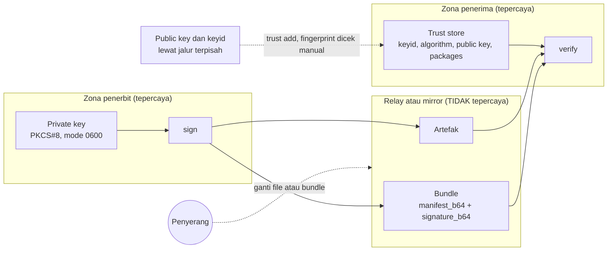
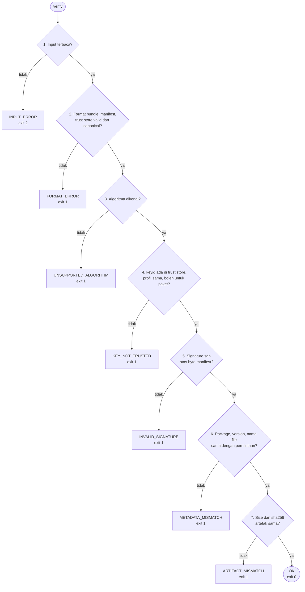

# Analisis Keamanan dan Threat Model

Dokumen ini menjelaskan apa yang dilindungi release-signer, dari siapa, dan bukti
mitigasinya. Setiap klaim menunjuk ke file kode atau ID tes. Bagian yang belum
terbukti ditandai **Belum** beserta issue yang akan menutupnya.

## 1. Aset

| Aset | Alasan penting | Lokasi |
|---|---|---|
| Private key penerbit | Siapa pun yang memegangnya bisa menerbitkan rilis atas nama penerbit | File `*.key.pem` (PKCS#8), secret CI |
| Trust store | Menentukan key mana yang dipercaya dan untuk paket apa | `trust.json` milik penerima |
| Artefak rilis | Yang akan dijalankan atau dipasang penerima | Dikirim lewat relay |
| Bundle | Memuat manifest dan signature | Dikirim bersama artefak |
| Image program | Menjalankan sign dan verify di pipeline | GHCR |

## 2. Arsitektur dan batas kepercayaan

Kepercayaan hanya berasal dari trust store penerima. Relay, bundle, dan artefak
dianggap tidak tepercaya sampai lolos verify.

Poin desain yang menentukan keamanan:

- Bundle tidak membawa public key. Penyerang tidak bisa memperkenalkan key sendiri.
- `trust add` adalah satu-satunya jalan menambah kepercayaan, dan dijalankan manual
  oleh penerima. `verify` tidak pernah menulis trust store.
- Izin key dibatasi per paket, jadi key untuk paket A tidak sah untuk paket B.
- Verify berhenti di kegagalan pertama dan tidak mencoba key, profil, atau trust
  store lain.

## 3. Alur verifikasi sebagai gerbang

Urutan mengikuti Tabel 2.8 spek dan ditulis di `pkg/release/verify.go`.

Signature dicek atas byte manifest persis seperti yang ada di bundle. Manifest tidak
diformat ulang sebelum dicek, dan canonical check membandingkan hasil serialisasi
ulang dengan byte asli.

## 4. Threat model

| # | Ancaman | Dampak | Mitigasi | Bukti |
|---|---|---|---|---|
| T1 | Relay mengganti artefak | Penerima memasang file palsu | Hash dan size artefak dicek terhadap manifest yang bertanda tangan | U02, U03, `TestVerifyArtifactTamper` |
| T2 | Relay mengganti artefak dan manifest | File palsu dengan hash cocok | Manifest diubah berarti signature tidak cocok | U04, `TestVerifyInvalidSignature`, `TestVerifyManifestVersionModifiedInvalidSignature` |
| T3 | Penyerang menandatangani dengan key sendiri dan menulis keyid-nya | Rilis palsu lolos secara kriptografis | Key hanya dipercaya jika ada di trust store | U12, `TestVerifyUnknownKeySameProfile` |
| T4 | Key sah untuk paket lain dipakai untuk paket ini | Penerbit satu paket menerbitkan paket lain | Izin key per paket | U07, `TestVerifyKeyNotTrusted` |
| T5 | Key dicabut atau trust store kosong | Rilis lama dari key bermasalah tetap diterima | Verify hanya memakai isi trust store saat itu | U06, `TestVerifyEmptyTrustStore` |
| T6 | Bundle atau manifest cacat: duplicate key, tipe salah, Base64 invalid, terlalu besar | Parser berbeda membaca isi berbeda | `pkg/strictjson`, `pkg/b64`, batas 16 KiB dan 64 KiB | U10a sampai U10d, `Neg_BundleTooLarge`, tes di `pkg/strictjson` dan `pkg/b64` |
| T7 | Manifest tidak canonical atau di-reformat | Dua byte berbeda untuk isi sama | Serialisasi ulang lalu bandingkan byte | `TestVerifyNonCanonicalManifest`, `pkg/manifest` |
| T8 | Algorithm confusion atau downgrade | Verifikasi memakai algoritma lemah atau salah | Hanya 3 profil, profil key harus sama dengan manifest | U11, `TestVerifyUnsupportedAlgorithm`, `TestVerifyKeyProfileMismatch`, `Neg_ProfileMismatch` |
| T9 | Nama file atau versi tidak sesuai | Rilis lain diterima sebagai yang diminta | Package, version, dan basename dicek persis | U08, U09, `TestVerifyMetadataMismatch`, `TestVerifyArtifactRenamed` |
| T10 | ECDSA dengan r atau s di luar domain | Verifier crash atau menerima nilai ilegal | r, s dicek rentangnya, hasilnya `INVALID_SIGNATURE` | `TestVerifyECDSARZero`, `TestECDSABoundaries` |
| T11 | Trust store rusak saat gagal tulis | Kepercayaan hilang atau korup | Tulis ke temp file lalu rename | `TestSaveFailurePreservesStore` |
| T12 | Private key bocor | Penyerang menerbitkan rilis sah | Lihat bagian 5.1 | `TestWriteKeyPair`, `TestSignRejectsUnsupportedKeys` |
| T13 | Image program diganti | Tool penandatangan atau verifikasi dimanipulasi | Pin image lewat digest | `ci/image.env`, `release-pipeline.yml`, `ci-integration.yml` |
| T14 | Rollback ke rilis lama yang sah | Penerima memasang versi rentan | Sebagian, lihat bagian 5.5 | `TestVerifyMetadataMismatch` (hanya jika versi dipin) |

## 5. Pembahasan wajib

### 5.1 Kebocoran private key

- File kunci dibuat dengan mode `0600` dan `O_EXCL`, sehingga tidak menimpa file lama
  tanpa `--force`. Kode: `keys.WriteKeyPair` di `pkg/keys/keys.go`. Tes: `TestWriteKeyPair`.
- Isi kunci tidak pernah masuk bundle. Bundle hanya berisi `schema`, `manifest_b64`,
  dan `signature_b64`. Kode: `pkg/bundle/bundle.go`.
- Kegagalan membaca kunci memakai pesan generik, karena error dari parser PEM bisa
  memuat label seperti `RSA PRIVATE KEY`. Kode: `pkg/release/sign.go`. Tes:
  `TestSignRejectsUnsupportedKeys` memastikan error tidak memuat `PRIVATE KEY` maupun isi kunci.
- Image dibangun tanpa kunci. `.dockerignore` mengecualikan `*.pem`, `*.key`, dan
  `test/keys/`, dan image akhir memakai `distroless/static:nonroot` hanya dengan satu binary.
  Bukti: `Dockerfile` dan `.dockerignore`.
- Verify tidak menerima private key sama sekali. Job `verify` dan `deploy` di
  `.github/workflows/release-pipeline.yml` berjalan tanpa akses ke secret penandatanganan.

### 5.2 Reuse nonce ECDSA

Dua signature ECDSA dengan nonce `k` yang sama atas pesan berbeda membocorkan
private key. Program tidak memilih nonce sendiri. `ecdsa.Sign` dari Go memakai
nonce yang diturunkan dari CSPRNG dan dicampur dengan private key serta hash pesan
(hedged), jadi kegagalan RNG saja tidak cukup untuk mengulang nonce.

Bukti perilakunya: `TestSignatureDeterminismAcrossRuns` di `pkg/sigalg` dan skenario
U14 menunjukkan signature RSA-PSS dan ECDSA atas manifest yang sama berbeda tiap
kali sign, sedangkan Ed25519 identik karena deterministik (RFC 8032). Ketiganya lolos verify.

### 5.3 Kesalahan parameter

| Risiko | Penjagaan | Bukti |
|---|---|---|
| RSA bukan 3072 bit atau e bukan 65537 | `ProfileOf` menolak | `TestProfileOf_Rejections` |
| Kurva selain P-256 | `ProfileOf` menolak | `TestProfileOf_Rejections` |
| Salt PSS salah | Salt 32 byte eksplisit, bukan auto | `TestRSAPSSRejectNon32ByteSalt` |
| Double hashing RSA dan ECDSA | SHA-256 dihitung sekali atas manifest | `TestDoubleHashingGuards` |
| Ed25519ph | Hanya `ed25519.Sign` atas pesan asli | `TestRFC8032TestVector1` |
| Label PEM atau format kunci salah | Hanya `PRIVATE KEY` (PKCS#8) dan `PUBLIC KEY` (SPKI) | `TestParsePEM_Rejections` |
| keyid berubah karena line ending | keyid dari ekspor ulang DER | `TestPEMLineEndingsAndFolding` |

### 5.4 Public key dari sumber tidak tepercaya

- Bundle tidak membawa public key, jadi tidak ada key yang bisa "dikirim" penyerang.
- `trust add` menampilkan fingerprint, algoritma, dan paket. Penerima wajib mencocokkan
  fingerprint dengan sumber terpercaya sebelum menjalankannya. Program tidak bisa
  memeriksa ini, itu tanggung jawab penerima.
- Entri trust store divalidasi ketat: fingerprint harus cocok dengan PEM, profil
  harus cocok dengan tipe kunci, paket tidak boleh kosong, duplikat, atau wildcard.
  Tes: `TestLoadRejects`, `TestLoadErrors`.
- Tidak ada pembaruan otomatis. `verify` tidak menulis trust store.

### 5.5 Rollback attack

**Rancangan saat ini tidak mencegah rollback sepenuhnya.**

Manifest memuat versi, dan verify menolak jika versi di manifest berbeda dari
`--version` yang diminta (`METADATA_MISMATCH`, `TestVerifyMetadataMismatch`). Itu
melindungi penerima yang **memin versi** sendiri dari konfigurasi tepercaya.

Yang tidak tercegah:

- Penerima yang mengambil nilai `--version` dari relay yang sama. Penyerang
  menyajikan bundle dan artefak lama yang sah (misalnya 1.0.0 yang rentan) bersama
  klaim "versi terbaru adalah 1.0.0", dan verify akan menerimanya.
- Bundle tidak punya waktu kedaluwarsa. Bundle lama yang sah tetap lolos selama
  key-nya ada di trust store.
- Tidak ada pencabutan per rilis. Satu-satunya cara adalah `trust remove`, yang
  mencabut seluruh key.

Trusted state tambahan yang dibutuhkan untuk mendeteksinya:

1. **Versi tertinggi per paket** yang pernah diterima, disimpan di sisi penerima, dan
   verify menolak versi yang lebih rendah (counter monoton).
2. **Waktu kedaluwarsa dan timestamp** pada metadata, mengikuti pola TUF
   (timestamp, snapshot), supaya bundle lama kedaluwarsa.
3. **Transparency log** atau daftar pencabutan untuk rilis tertentu.

Tiga hal itu di luar cakupan tugas dan tidak diimplementasikan.

### 5.6 Parser dan canonicalization

- Duplicate key dideteksi saat parsing di semua level, termasuk yang ditulis lewat
  escape. Kode: `pkg/strictjson`. Tes: U10a dan tes `pkg/strictjson`.
- Field tambahan, `null`, dan tipe salah ditolak. Integer harus plain decimal dan
  maksimum 2^53 - 1. Kode: `pkg/strictjson`, `pkg/manifest`.
- Batas ukuran dicek sebelum parsing: 16 KiB untuk manifest, 64 KiB untuk bundle.
- Base64 harus RFC 4648 ketat: tanpa whitespace, padding benar, dan encode ulang
  harus sama dengan input. Kode: `pkg/b64`.

## 6. Batasan dan hal yang belum terbukti

**Batasan desain**

- Signature membuktikan keaslian dan integritas, bukan bahwa kode bebas malware.
- Tidak ada revocation selain `trust remove`, dan tidak ada timestamp (lihat 5.5).
- Keamanan bergantung pada penerima yang memeriksa fingerprint sebelum `trust add`.
- Kompromi runner atau host penerima di luar cakupan.

**Status pembuktian antar-issue**

| Hal | Status | Issue |
|---|---|---|
| Image dikunci lewat digest | Sudah (`ci/image.env` memakai `@sha256:...`; digest final `v1.0.0` dan uji pull publik dipin ulang sebelum rilis) | #14, #22 |
| Verify tanpa akses secret dan deploy bergantung verify | Sudah (`.github/workflows/release-pipeline.yml`) | #15 |
| Jalan dengan `--network none`, `--user`, tanpa TTY | Sudah diuji pada container terisolasi (`results/ci/C05/`) | #16 (C05) |
| Skenario C01 sampai C05 | Sudah diuji lokal + workflow `.github/workflows/ci-integration.yml` (`results/ci/`) | #16 |
| Signed SBOM (S01 sampai S05) | Belum diimplementasikan | #18 |
| Interoperabilitas dengan OpenSSL dan Python | Sudah (`results/interop/results.md`) | #13 |

## 7. Pemetaan ke skenario uji

| Skenario | Menguji | Ancaman |
|---|---|---|
| U01 | Sign dan verify teks, biner, kosong untuk 3 profil | dasar |
| U02, U03 | Artefak diubah, ditambah, dikurangi | T1 |
| U04, U05 | Versi manifest diubah, satu bit signature diubah | T2 |
| U06 | Trust store kosong atau key dicabut | T5 |
| U07 | Key hanya untuk paket lain | T4 |
| U08, U09 | Versi atau nama file beda | T9 |
| U10a sampai U10d | Duplicate key, tipe salah, Base64 invalid, terlalu besar | T6 |
| U11 | Algoritma tidak didukung | T8 |
| U12 | Key lain, tidak ada di trust store | T3 |
| U13 | Bundle di-reformat tetap diterima | T7 (bundle bebas format) |
| U14 | Signature berulang berbeda atau identik sesuai algoritma | 5.2 |
| C01 sampai C05 | Integrasi CI/CD | T13, 5.1 (`.github/workflows/ci-integration.yml`, `results/ci/`) |
| S01 sampai S05 | Signed SBOM | (**Belum**, #18) |
