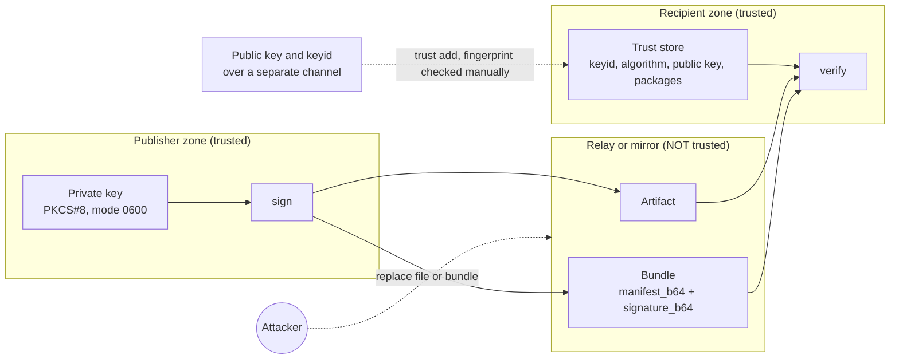
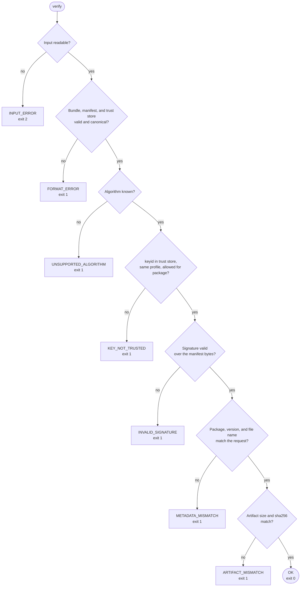

# Security Analysis and Threat Model

This document explains what release-signer protects, from whom, and the evidence for each mitigation. Every claim points to a code file or a test ID.

## 1. Assets

| Asset | Why it matters | Location |
|---|---|---|
| Publisher private key | Whoever holds it can publish releases on behalf of the publisher | `*.key.pem` files (PKCS#8), CI secret |
| Trust store | Decides which keys are trusted and for which packages | `trust.json` owned by the recipient |
| Release artifact | What the recipient will run or install | Delivered through a relay |
| Bundle | Holds the manifest and signature | Delivered with the artifact |
| Program image | Runs sign and verify in the pipeline | GHCR |

## 2. Architecture and trust boundaries

Trust only comes from the recipient's trust store. The relay, the bundle, and the artifact are untrusted until they pass verify.

Design points that decide security:

- The bundle does not carry a public key. An attacker cannot introduce their own key.
- `trust add` is the only way to add trust, and the recipient runs it manually. `verify` never writes the trust store.
- Key permissions are scoped per package, so a key for package A is not valid for package B.
- Verify stops at the first failure and never tries another key, profile, or trust store.

## 3. The verification flow as a gate

The order follows Table 2.8 of the spec and is implemented in `pkg/release/verify.go`.

The signature is checked over the manifest bytes exactly as they are in the bundle. The manifest is not reformatted before the check, and the canonical check compares the re-serialized result with the original bytes.

## 4. Threat model

| # | Threat | Impact | Mitigation | Evidence |
|---|---|---|---|---|
| T1 | Relay replaces the artifact | Recipient installs a fake file | Artifact hash and size are checked against the signed manifest | U02, U03, `TestVerifyArtifactTamper` |
| T2 | Relay replaces the artifact and the manifest | Fake file with a matching hash | A modified manifest means the signature no longer matches | U04, `TestVerifyInvalidSignature`, `TestVerifyManifestVersionModifiedInvalidSignature` |
| T3 | Attacker signs with their own key and writes its keyid | Fake release passes cryptographically | A key is only trusted if it is in the trust store | U12, `TestVerifyUnknownKeySameProfile` |
| T4 | A key valid for another package is used for this one | One package's publisher publishes another package | Per-package key permission | U07, `TestVerifyKeyNotTrusted` |
| T5 | Key revoked or trust store empty | Old releases from a problematic key are still accepted | Verify only uses the trust store contents at that moment | U06, `TestVerifyEmptyTrustStore` |
| T6 | Malformed bundle or manifest: duplicate key, wrong type, invalid Base64, too large | Different parsers read different content | `pkg/strictjson`, `pkg/b64`, 16 KiB and 64 KiB limits | U10a to U10d, `Neg_BundleTooLarge`, tests in `pkg/strictjson` and `pkg/b64` |
| T7 | Non-canonical or reformatted manifest | Two different byte sequences for the same content | Re-serialize and compare bytes | `TestVerifyNonCanonicalManifest`, `pkg/manifest` |
| T8 | Algorithm confusion or downgrade | Verification uses a weak or wrong algorithm | Only 3 profiles, the key profile must equal the manifest | U11, `TestVerifyUnsupportedAlgorithm`, `TestVerifyKeyProfileMismatch`, `Neg_ProfileMismatch` |
| T9 | File name or version does not match | Another release is accepted as the requested one | Package, version, and basename are checked exactly | U08, U09, `TestVerifyMetadataMismatch`, `TestVerifyArtifactRenamed` |
| T10 | ECDSA with r or s outside the domain | Verifier crashes or accepts an illegal value | r and s are range checked, the result is `INVALID_SIGNATURE` | `TestVerifyECDSARZero`, `TestECDSABoundaries` |
| T11 | Trust store corrupted by a failed write | Trust is lost or corrupted | Write to a temp file, then rename | `TestSaveFailurePreservesStore` |
| T12 | Private key leak | Attacker publishes valid releases | See section 5.1 | `TestWriteKeyPair`, `TestSignRejectsUnsupportedKeys` |
| T13 | Program image replaced | Signing or verification tool is tampered with | Pin the image by digest | `ci/image.env`, `release-pipeline.yml`, `ci-integration.yml` |
| T14 | Rollback to an old legitimate release | Recipient installs a vulnerable version | Partial, see section 5.5 | `TestVerifyMetadataMismatch` (only if the version is pinned) |

## 5. Required discussion

### 5.1 Private key leak

- Key files are created with mode `0600` and `O_EXCL`, so they do not overwrite an old file without `--force`. Code: `keys.WriteKeyPair` in `pkg/keys/keys.go`. Test: `TestWriteKeyPair`.
- The key content never enters the bundle. The bundle only holds `schema`, `manifest_b64`, and `signature_b64`. Code: `pkg/bundle/bundle.go`.
- A failure to read a key uses a generic message, because an error from the PEM parser can contain a label such as `RSA PRIVATE KEY`. Code: `pkg/release/sign.go`. Test: `TestSignRejectsUnsupportedKeys` checks that the error contains neither `PRIVATE KEY` nor the key content.
- The image is built without keys. `.dockerignore` excludes `*.pem`, `*.key`, and `test/keys/`, and the final image uses `distroless/static:nonroot` with a single binary. Evidence: `Dockerfile` and `.dockerignore`.
- Verify accepts no private key at all. The `verify` and `deploy` jobs in `.github/workflows/release-pipeline.yml` run without access to the signing secrets.

### 5.2 ECDSA nonce reuse

Two ECDSA signatures with the same nonce `k` over different messages leak the private key. The program does not choose the nonce itself. Go's `ecdsa.Sign` uses a nonce derived from the CSPRNG and mixed with the private key and the message hash (hedged), so an RNG failure alone is not enough to repeat a nonce.

Evidence of the behavior: `TestSignatureDeterminismAcrossRuns` in `pkg/sigalg` and scenario U14 show that RSA-PSS and ECDSA signatures over the same manifest differ on every sign, while Ed25519 is identical because it is deterministic (RFC 8032). All three pass verify.

### 5.3 Parameter mistakes

| Risk | Safeguard | Evidence |
|---|---|---|
| RSA that is not 3072 bits or e is not 65537 | `ProfileOf` rejects it | `TestProfileOf_Rejections` |
| A curve other than P-256 | `ProfileOf` rejects it | `TestProfileOf_Rejections` |
| Wrong PSS salt | Explicit 32 byte salt, not auto | `TestRSAPSSRejectNon32ByteSalt` |
| Double hashing for RSA and ECDSA | SHA-256 is computed once over the manifest | `TestDoubleHashingGuards` |
| Ed25519ph | Only `ed25519.Sign` over the original message | `TestRFC8032TestVector1` |
| Wrong PEM label or key format | Only `PRIVATE KEY` (PKCS#8) and `PUBLIC KEY` (SPKI) | `TestParsePEM_Rejections` |
| keyid changes because of line endings | keyid comes from the re-exported DER | `TestPEMLineEndingsAndFolding` |

### 5.4 Public key from an untrusted source

- The bundle does not carry a public key, so there is no key an attacker can "send".
- `trust add` shows the fingerprint, algorithm, and package. The recipient must compare the fingerprint with a trusted source before running it. The program cannot check this, it is the recipient's responsibility.
- Trust store entries are validated strictly: the fingerprint must match the PEM, the profile must match the key type, and packages must not be empty, duplicated, or wildcards. Tests: `TestLoadRejects`, `TestLoadErrors`.
- There is no automatic update. `verify` does not write the trust store.

### 5.5 Rollback attack

**The current design does not fully prevent rollback.**

The manifest carries the version, and verify rejects a manifest whose version differs from the requested `--version` (`METADATA_MISMATCH`, `TestVerifyMetadataMismatch`). This protects a recipient who **pins the version** itself from trusted configuration.

What is not prevented:

- A recipient that takes the `--version` value from the same relay. The attacker serves an old legitimate bundle and artifact (for example a vulnerable 1.0.0) together with the claim that "the latest version is 1.0.0", and verify accepts it.
- The bundle has no expiry time. An old legitimate bundle still passes as long as its key is in the trust store.
- There is no per-release revocation. The only way is `trust remove`, which revokes the whole key.

Additional trusted state needed to detect it:

1. **Highest version per package** ever accepted, stored on the recipient side, with verify rejecting a lower version (monotonic counter).
2. **Expiry time and timestamp** in the metadata, following the TUF pattern (timestamp, snapshot), so old bundles expire.
3. A **transparency log** or revocation list for specific releases.

Those three are outside the scope of the assignment and are not implemented.

### 5.6 Parser and canonicalization

- Duplicate keys are detected during parsing at every level, including ones written through an escape. Code: `pkg/strictjson`. Tests: U10a and the `pkg/strictjson` tests.
- Extra fields, `null`, and wrong types are rejected. Integers must be plain decimal and at most 2^53 - 1. Code: `pkg/strictjson`, `pkg/manifest`.
- Size limits are checked before parsing: 16 KiB for the manifest and 64 KiB for the bundle.
- Base64 must be strict RFC 4648: no white space, correct padding, and re-encoding must equal the input. Code: `pkg/b64`.

## 6. Limitations and unproven items

**Design limitations**

- A signature proves authenticity and integrity, not that the code is free of malware.
- There is no revocation other than `trust remove`, and no timestamp (see 5.5).
- Security depends on the recipient checking the fingerprint before `trust add`.
- A compromised runner or recipient host is out of scope.

**Proof status per issue**

| Item | Status | Issue |
|---|---|---|
| Image pinned by digest | Done (`ci/image.env` uses `@sha256:...`, the final `v1.0.0` digest and the public pull test are re-pinned before the release) | #14, #22 |
| Verify without secret access and deploy depends on verify | Done (`.github/workflows/release-pipeline.yml`) | #15 |
| Runs with `--network none`, `--user`, and no TTY | Tested in an isolated container (`results/ci/C05/`) | #16 (C05) |
| Scenarios C01 to C05 | Tested locally and through `.github/workflows/ci-integration.yml` (`results/ci/`) | #16 |
| Signed SBOM (S01 to S09) | Done (`results/sbom/`, [Signed SBOM](sbom.md)) | #18 |
| Interoperability with OpenSSL and Python | Done (`results/interop/results.md`) | #13 |

## 7. Mapping to test scenarios

| Scenario | Tests | Threat |
|---|---|---|
| U01 | Sign and verify text, binary, and empty for 3 profiles | baseline |
| U02, U03 | Artifact changed, extended, or truncated | T1 |
| U04, U05 | Manifest version changed, one signature bit changed | T2 |
| U06 | Empty trust store or revoked key | T5 |
| U07 | Key only for another package | T4 |
| U08, U09 | Different version or file name | T9 |
| U10a to U10d | Duplicate key, wrong type, invalid Base64, too large | T6 |
| U11 | Unsupported algorithm | T8 |
| U12 | Another key, not in the trust store | T3 |
| U13 | A reformatted bundle is still accepted | T7 (the bundle format is free) |
| U14 | Repeated signatures differ or are identical depending on the algorithm | 5.2 |
| C01 to C05 | CI/CD integration | T13, 5.1 (`.github/workflows/ci-integration.yml`, `results/ci/`) |
| S01 to S09 | Signed SBOM | [Signed SBOM](sbom.md) |
